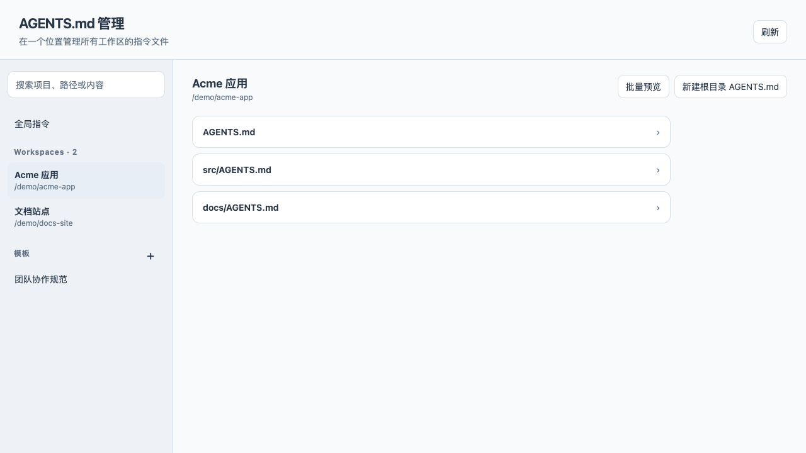
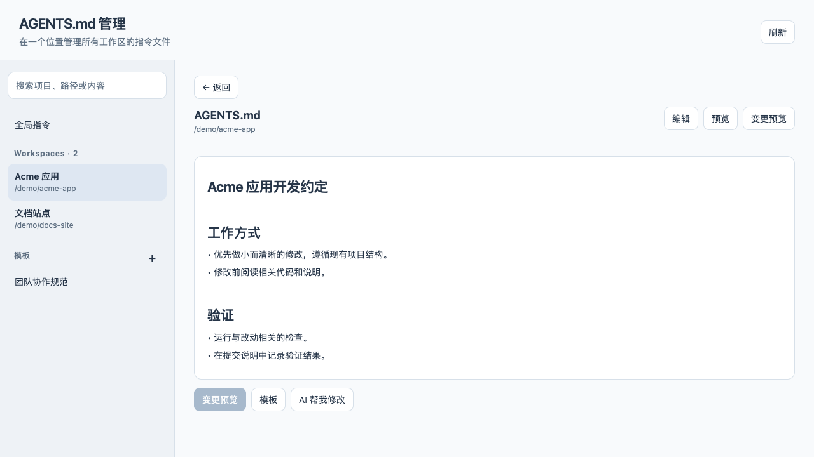
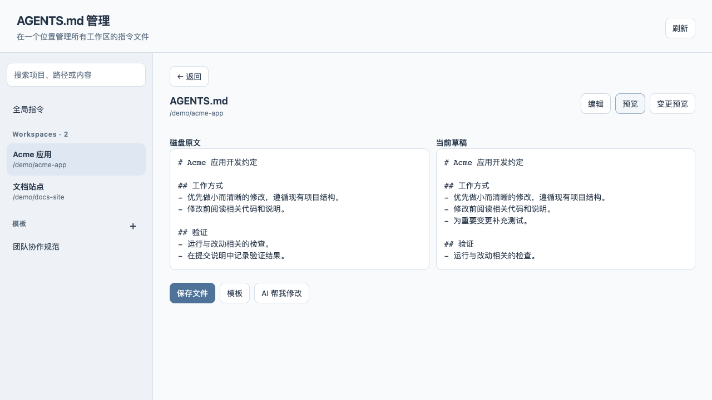
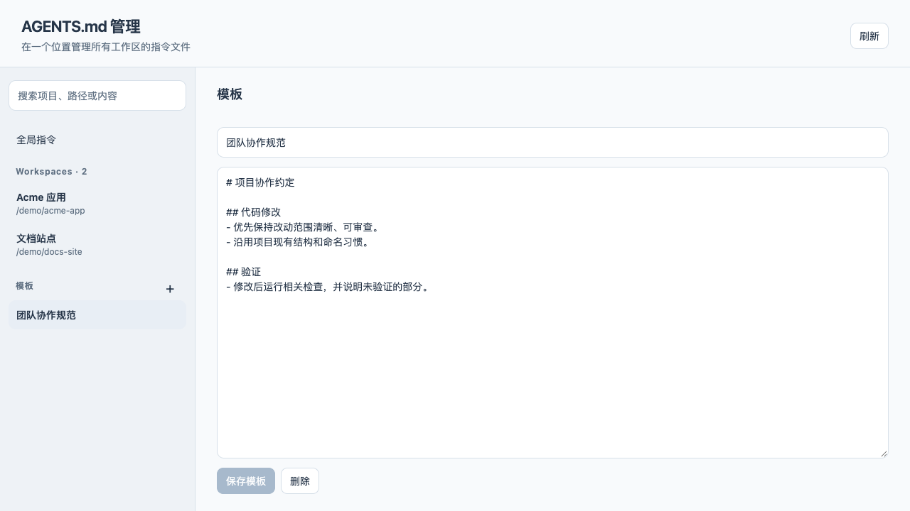

# DSH AGENTS.md Manager

[简体中文](README.md) | [English](README.en.md)

A focused DeepSeek Harness Desktop plugin for finding and editing `AGENTS.md` files across registered workspaces. The files stay in their original locations.

## Features

- List root and nested `AGENTS.md` files in registered workspaces, plus the two DSH global instruction files.
- Search workspace names, paths, and file contents.
- Preview the contents of up to 100 files together in a workspace or the global section.
- Edit Markdown, preview it, review the original and draft side by side, and save one file at a time. Saves check the file version and use an atomic replacement.
- Create and edit local templates from the sidebar's Templates section. Its + button opens a new template; selecting a template opens its editor. Applying a template changes only the file editor draft.
- Request a single model suggestion using a configured DSH provider. The suggestion must be accepted into the draft and saved manually.
- Chinese and English interface, with narrow-screen navigation. The file editor has a back button, and leaving an unsaved file or template draft requires confirmation.

## Screenshots

These screenshots render the plugin's web client with fictional workspaces and files; the `/demo/...` paths are example data.

| Workspace files | Markdown preview |
| --- | --- |
|  |  |
| Review changes | Template editor |
|  |  |

## Local installation

In DeepSeek Harness Desktop, open the plugin manager, choose the option to install from a local directory, and select this repository's root directory. The plugin is a source bundle; no build step or npm install is required. Restart or reload the Desktop app if its plugin manager requests it. Use the `desktop` profile.

## Development

Requires Node.js 20 or later. Run `npm run check` for JavaScript syntax and focused tests. The host entry is `index.js`, the web client is `client.js`, and the DSH bundle declaration is `cordis.patch.yml`.

The plugin scans only registered workspaces. It skips common dependency and build directories and bounds traversal to 20 levels and 20,000 directories per workspace. A workspace scan error is shown with that workspace; other workspaces remain available. The two global paths come from `DSH_HOME` (default `~/.dsh`) and `DSH_AGENTS_HOME` (default `~/.agents`). Templates are stored in `DSH_HOME/agentsmd-manager/templates.json`.

The model receives the current draft, the user's request, and available root README and supported project manifest files (up to 16,384 characters each). The UI identifies these inputs before generation. The model's output is a proposal and never writes a file automatically. Each independent model call is recorded before dispatch in `DSH_HOME/agentsmd-manager/requests/` with the exact prompt and context; the file is private to the local user. The record is updated with the result or failure. The AI panel offers cancellation. Do not use the AI action for confidential project instructions unless the configured model is authorized to receive them.

This version does not bulk write files, move instruction files, or change DSH's instruction loading behavior.

## License

MIT. See [LICENSE](LICENSE).
