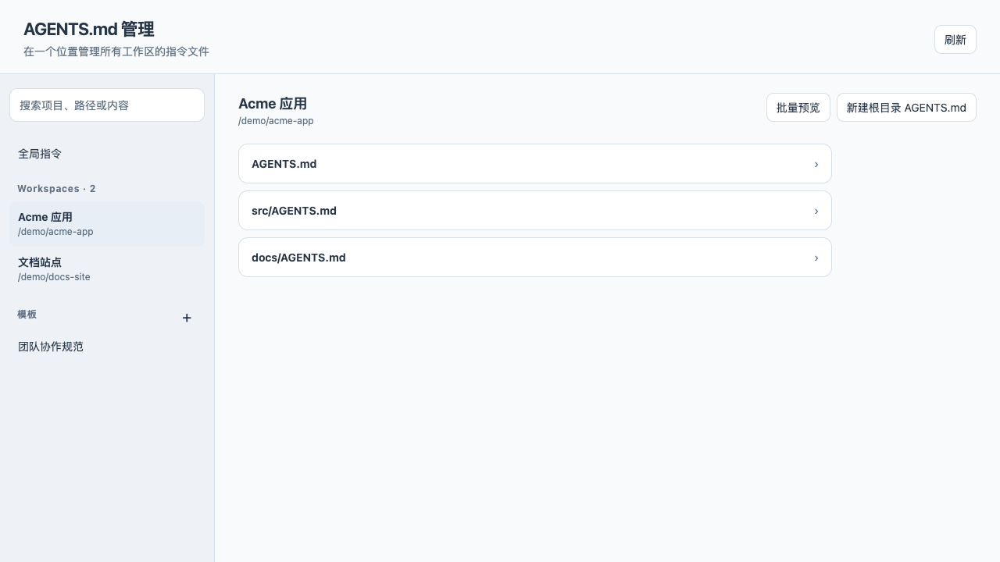
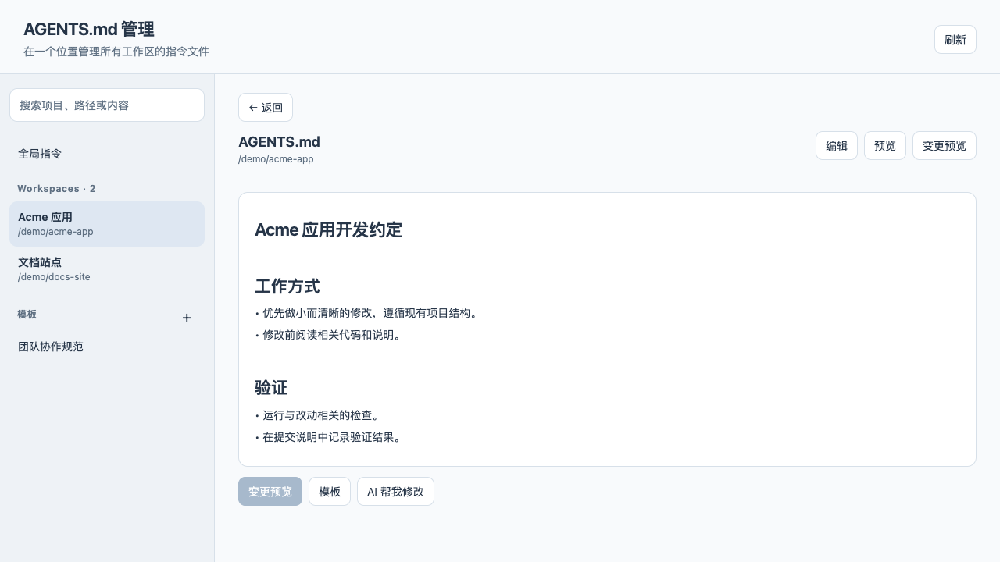
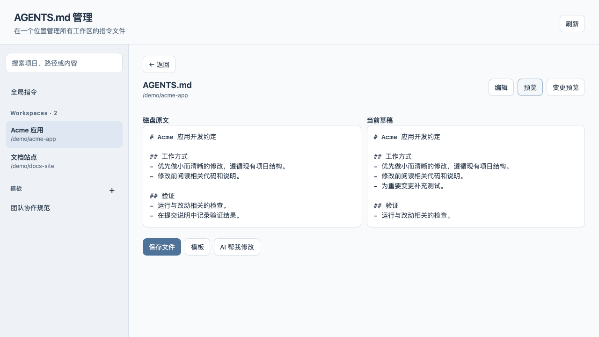
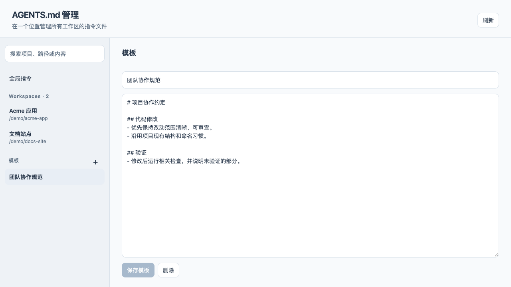

# DSH AGENTS.md Manager

[简体中文](README.md) | [English](README.en.md)

这是一个专注于 `AGENTS.md` 管理的 DeepSeek Harness Desktop 插件。它将已注册工作区中的指令文件集中展示，方便查找和编辑；文件始终保留在原位置。

## 功能

- 列出已注册工作区根目录和子目录中的 `AGENTS.md`，以及 DSH 的两个全局指令文件。
- 按工作区名称、路径和文件内容搜索。
- 一次预览单个工作区或全局区域中最多 100 个文件的内容。
- 编辑和预览 Markdown，并在保存前并排比较磁盘原文与当前草稿。每次只保存一个文件；保存时检查文件版本，并采用原子替换。
- 在侧栏的「模板」区域新建和编辑本地模板。点击 + 新建模板，点击模板名称打开编辑器。应用模板只会修改文件编辑器中的草稿。
- 使用 DSH 已配置的模型请求单次修改建议。建议需要先手动采用到草稿，再手动保存。
- 提供中英双语界面和窄屏导航。文件编辑器支持返回；离开有未保存改动的文件或模板时会请求确认。

## 截图

以下截图使用插件的实际 Web Client 和虚构的工作区及文件数据渲染；`/demo/...` 为示例路径。

| 工作区文件 | Markdown 预览 |
| --- | --- |
|  |  |
| 保存前变更预览 | 模板编辑 |
|  |  |

## 本地安装

在 DeepSeek Harness Desktop 中打开插件管理页，选择从本地目录安装，并指定本仓库的根目录。插件以源码 bundle 形式提供，无需构建或执行 `npm install`。如果插件管理页提示，请重启或重新加载 Desktop。使用 `desktop` profile。

## 开发

需要 Node.js 20 或更高版本。运行 `npm run check` 检查 JavaScript 语法并执行相关测试。Host 入口为 `index.js`，Web Client 为 `client.js`，DSH bundle 声明位于 `cordis.patch.yml`。

插件只扫描已注册的工作区，跳过常见的依赖目录和构建目录，并将遍历限制为每个工作区最多 20 层、20,000 个目录。某个工作区扫描失败时，该工作区会显示错误，其他工作区仍可使用。两个全局文件的路径分别由 `DSH_HOME`（默认 `~/.dsh`）和 `DSH_AGENTS_HOME`（默认 `~/.agents`）确定。模板保存在 `DSH_HOME/agentsmd-manager/templates.json`。

模型会收到当前草稿、用户要求，以及可用的项目根目录 README 和受支持的项目清单文件（每个文件最多 16,384 个字符）。生成前，界面会列明这些输入。模型输出仅作为建议，不会自动写入文件。每次独立的模型调用在发出前，都会将完整提示词和上下文记录到 `DSH_HOME/agentsmd-manager/requests/`；该文件仅供本机用户读取，并会在调用完成或失败后更新结果。AI 面板支持取消。只有在所配置的模型获准接收项目机密指令时，才应对这类文件使用 AI 功能。

当前版本不支持批量写入多个文件，不移动指令文件，也不改变 DSH 原有的指令加载方式。

## 许可证

MIT，详见 [LICENSE](LICENSE)。
